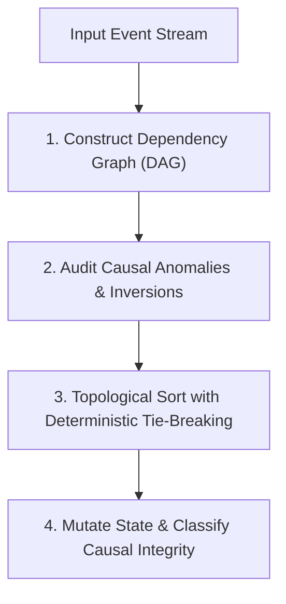

# Multi-Feed Causal Event Ordering Specification — RAILGORITHM v2.5

## 1. Scope & Theoretical Foundation

In distributed railway networks, telemetry originates from heterogeneous, asynchronous data sources: track circuits, electronic interlocking loggers, axle counter evaluators, train-borne GPS units, and Section Control office entries.

Each source operates with independent local sequence counters, distinct network transit latencies, and separate unsynchronized real-time clocks. Reconstructing corridor state by sorting naively on wall-clock timestamps or assuming global sequence numbers creates severe temporal and physical contradictions (e.g., trains appearing to exit a block before entering it, or false conflict warnings).

RAILGORITHM v2.5 implements a formal causal event reconstruction engine based on **Lamport's Happens-Before Relation** and **Directed Acyclic Graph (DAG) Topological Sorting**, while explicitly rejecting the false assumption that deterministic tie-breaking constitutes physical causal proof.

---

## 2. The Six Distinct Ordering Dimensions

For every telemetry event, RAILGORITHM v2.5 decouples and tracks six independent ordering parameters:

| Dimension | Attribute Name | Definition & Provenance | Role in Ordering |
| :--- | :--- | :--- | :--- |
| **1. Source Timestamp** | `timestamp` / `source_timestamp` | Time of event occurrence recorded by field sensor clock. | Primary physical timeline indicator. |
| **2. Server Receive Time** | `ingested_at` / `receive_timestamp` | Monotonic UTC time when event crossed system ingestion boundary. | Drift detection and network transit latency audit. |
| **3. Feed-Local Sequence** | `sequence_num` | Monotonically increasing counter generated per feed source. | Enforces strict FIFO order within the same feed. |
| **4. Event Identifier** | `event_id` | Globally unique event identifier (UUID or authentic token). | Idempotency deduplication and canonical hashing. |
| **5. Source Clock Skew** | `clock_skew_seconds` | Estimated NTP drift or clock uncertainty window. | Causal inversion tolerance margin. |
| **6. Causal Dependencies** | `causal_dependencies` | Explicit list of predecessor `event_id`s that must happen before this event. | Directed edges in causal reconstruction DAG. |

---

## 3. Causal DAG Reconstruction Algorithm

State reconstruction in `OperationalEventProcessor.replay_event_stream` executes a rigorous 4-stage pipeline:



### Stage 1: Dependency Graph Construction
For a set of events $E$:
1. **Intra-Feed Edges:** For all events originating from the same `feed_id`, events are ordered by `sequence_num`:
   $$\forall e_i, e_j \in E \text{ where } \text{feed}(e_i) = \text{feed}(e_j) \text{ and } \text{seq}(e_i) < \text{seq}(e_j) \implies e_i \to e_j$$
2. **Explicit Inter-Feed Edges:** For each dependency $d \in e.\text{causal\_dependencies}$:
   - If $d \in E$, add directed edge $d \to e$.
   - If $d \notin E$, flag an **unresolved causal dependency**.

### Stage 2: Causal Anomaly & Inversion Auditing
Before sorting, the engine inspects all causal edges $(u \to v)$ for temporal consistency:
- **Timestamp Inversion:** If predecessor $u$ has a timestamp later than dependent $v$, accounting for clock skew:
  $$\text{timestamp}(u) > \text{timestamp}(v) + \Delta_{\text{skew}}(u, v)$$
  An explicit warning is appended to `ordering_uncertainty_reasons`.
- **Cyclic Dependencies:** If cycle detection algorithms detect mutual dependencies ($u \to v \to \dots \to u$), a cyclic dependency anomaly is recorded.

### Stage 3: Topological Sorting with Deterministic Operational Tie-Breaking
Events with in-degree 0 (all causal predecessors satisfied) enter the active candidate pool.

When multiple candidate events are concurrently ready across different feeds:
$$\text{Sort Key} = (\text{timestamp}, \text{feed\_id}, \text{sequence\_num}, \text{event\_id})$$

> [!IMPORTANT]
> **Deterministic Tie-Breaking vs. Causal Proof:**
> Sorting concurrently ready events by `(timestamp, feed_id, sequence_num, event_id)` guarantees that two independent simulation nodes reconstruct **identical bit-for-bit operational state**.
> 
> However, RAILGORITHM v2.5 explicitly documents that this deterministic ordering is an **operational disambiguation convention**, **NOT mathematical proof of physical causality**. The system never claims to know the microscopic order of uncoupled physical events that occurred within sensor drift tolerance.

---

## 4. Operational Classification: Verified vs. Uncertain Replay

Following event stream replay, the reconstructed state is tagged with explicit integrity metadata:

```json
{
  "replay_status": "REPLAY_UNCERTAIN",
  "causal_integrity": "AMBIGUOUS",
  "is_authoritative_live": false,
  "ordering_uncertainty_reasons": [
    "Unresolved causal dependency: event 'B2' depends on missing event 'A1'.",
    "Causal timestamp inversion: predecessor 'C2' (10:10:00) is later than dependent 'C3' (10:02:00) by 480.0s."
  ]
}
```

### The Non-Authoritative Protection Invariant:
A state marked with `replay_status: "REPLAY_UNCERTAIN"` represents an ambiguous historical timeline.
**System Invariant:** An uncertain replay state **must NEVER** be designated as authoritative live operational state (`is_authoritative_live = False`), and dispatchers are presented with explicit advisory warnings.
