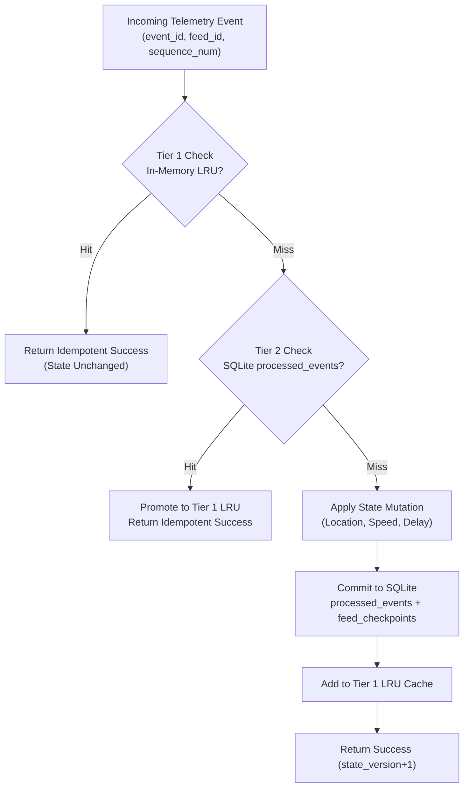

# DURABLE EVENT PROCESSING & 2-TIER IDEMPOTENCY — RAILGORITHM v2.4

## 1. Executive Summary

In mission-critical railway traffic monitoring, event deduplication and idempotent processing cannot rely solely on in-memory buffers. Network reconnections, worker restarts, and long operational sessions cause in-memory caches to evict keys or lose state, potentially causing duplicate mutations, corrupted train delays, or invalid conflict alerts.

RAILGORITHM v2.4 implements a **two-tier durable idempotency architecture**:
- **Tier 1 (High-Throughput In-Memory LRU Cache):** Evaluates incoming events in sub-microsecond CPU time (10,000-entry capacity).
- **Tier 2 (Durable SQLite Backing Store):** Persists every applied event into `processed_events` and updates `feed_checkpoints`, ensuring full idempotency survivability across cold process restarts and unbounded operational horizons.
- **Graceful Fault Degradation:** If disk I/O errors occur on SQLite, the pipeline degrades smoothly to in-memory mode (`DEGRADED_IN_MEMORY`) rather than crashing or blocking traffic dispatch.



---

## 2. Database Schema & Checkpoint Models

### 2.1 Table `processed_events`

Durable ledger of all acknowledged and applied movement events.

```sql
CREATE TABLE processed_events (
    id INTEGER PRIMARY KEY AUTOINCREMENT,
    feed_id VARCHAR(64) NOT NULL,
    sequence_num INTEGER NOT NULL,
    event_id VARCHAR(64) NOT NULL UNIQUE,
    payload_hash VARCHAR(64),
    processed_at DATETIME NOT NULL DEFAULT CURRENT_TIMESTAMP,
    state_version INTEGER NOT NULL DEFAULT 1,
    CONSTRAINT uq_feed_sequence UNIQUE (feed_id, sequence_num)
);
CREATE INDEX ix_processed_feed_seq ON processed_events (feed_id, sequence_num);
CREATE INDEX ix_processed_event_id ON processed_events (event_id);
```

### 2.2 Table `feed_checkpoints`

Monotonically advancing sequence watermark per telemetry provider feed.

```sql
CREATE TABLE feed_checkpoints (
    id INTEGER PRIMARY KEY AUTOINCREMENT,
    feed_id VARCHAR(64) NOT NULL UNIQUE,
    last_processed_sequence INTEGER NOT NULL,
    last_processed_timestamp DATETIME NOT NULL,
    last_event_id VARCHAR(64) NOT NULL,
    updated_at DATETIME NOT NULL DEFAULT CURRENT_TIMESTAMP
);
CREATE INDEX ix_feed_checkpoint_feed ON feed_checkpoints (feed_id);
```

---

## 3. Two-Tier Processing Flow & Guarantees

### 3.1 Idempotency Check (`is_processed`)

```python
def is_processed(self, event_id: str, db: Session | None = None, check_persistent: bool = True) -> bool:
    # Tier 1: Check fast in-memory LRU cache (< 1 µs)
    if event_id in self._processed_events:
        return True

    if not check_persistent:
        return False

    # Tier 2: Check persistent storage for survivability across server restarts & evictions
    try:
        if db is not None:
            rec = db.query(ProcessedEventRecord).filter(ProcessedEventRecord.event_id == event_id).first()
            if rec:
                self._cache_processed(event_id)
                return True
        else:
            with SessionLocal() as session:
                rec = session.query(ProcessedEventRecord).filter(ProcessedEventRecord.event_id == event_id).first()
                if rec:
                    self._cache_processed(event_id)
                    return True
    except Exception:
        if db is not None:
            try: db.rollback()
            except Exception: pass
        self.durability_mode = "DEGRADED_IN_MEMORY"

    return False
```

### 3.2 Mark Processed & Checkpoint Advance (`_mark_processed`)

```python
def _mark_processed(self, event: NormalizedMovementEvent, state_version: int, db: Session | None = None, persist: bool = True) -> None:
    # Update Tier 1 LRU cache
    self._cache_processed(event.event_id)
    if not persist:
        return

    # Update Tier 2 persistent store and feed checkpoints
    def _persist(session: Session) -> None:
        hash_val = getattr(event, "payload_hash", None)
        if not hash_val:
            hash_val = hashlib.sha256(f"{event.feed_id}:{event.sequence_num}:{event.event_id}".encode("utf-8")).hexdigest()

        rec = ProcessedEventRecord(
            feed_id=event.feed_id,
            sequence_num=event.sequence_num,
            event_id=event.event_id,
            payload_hash=hash_val,
            state_version=state_version,
        )
        session.add(rec)

        chk = session.query(FeedCheckpointRecord).filter(FeedCheckpointRecord.feed_id == event.feed_id).first()
        if not chk:
            chk = FeedCheckpointRecord(
                feed_id=event.feed_id,
                last_processed_sequence=event.sequence_num,
                last_processed_timestamp=event.timestamp,
                last_event_id=event.event_id,
            )
            session.add(chk)
        else:
            if event.sequence_num > chk.last_processed_sequence:
                chk.last_processed_sequence = event.sequence_num
                chk.last_processed_timestamp = event.timestamp
                chk.last_event_id = event.event_id
        session.commit()
```

---

## 4. Empirical Verification Evidence

The 2-tier idempotency architecture has been verified through comprehensive unit and fault-injection tests in `backend/tests/test_reliability_and_recovery.py`:

1. **Survives Simulated Server Restart (`test_durable_idempotency_survives_restart`):**
   - Verified that a completely fresh processor instance with empty RAM correctly identifies prior events as duplicates via Tier 2 SQLite records.
2. **Survives LRU Cache Eviction (`test_durable_idempotency_survives_lru_eviction`):**
   - Verified that when cache capacity is exceeded and early event IDs are evicted from memory, subsequent duplicates are intercepted by Tier 2 and promoted back to Tier 1 without mutating operational state.
3. **Database Disk Failure Graceful Degradation (`test_database_failure_graceful_degradation`):**
   - Injected database exceptions (`RuntimeError("Database disk I/O failure")`). The processor transitions transparently to `DEGRADED_IN_MEMORY` mode and processes operational movement without raising fatal HTTP 500 errors.
