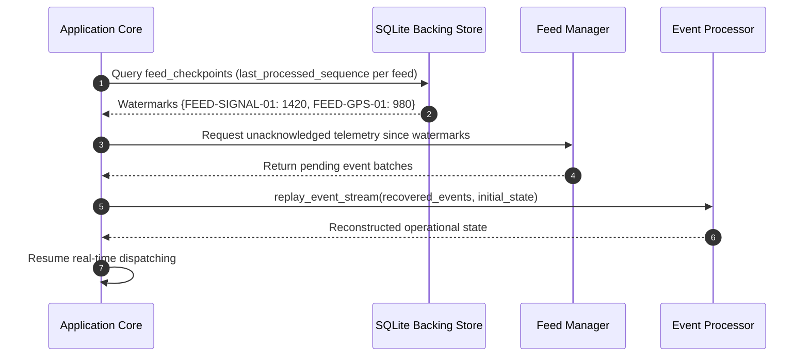

# EVENT REPLAY & MULTI-FEED DISASTER RECOVERY — RAILGORITHM v2.4

## 1. Problem Statement: Causality in Multi-Feed Railway Telemetry

In modern railway networks, telemetry originates from multiple independent signaling systems:
- Signal feeds (e.g. `FEED-SIGNAL-01`, `FEED-SIGNAL-02`)
- GPS / locomotive telematics (e.g. `FEED-GPS-01`)
- Electronic Interlocking / Axle Counter proving units (e.g. `FEED-AXLE-01`)

Each telemetry feed maintains its own local sequence numbers ($1, 2, 3, \dots$).
Prior systems naively sorted event streams using `(sequence_num, timestamp)`.

> [!CAUTION]
> **Why Sequence Sorting Across Feeds is Causally Invalid:**
> Feed A emitting sequence 1 at 10:05:00 and Feed B emitting sequence 1 at 10:01:00 have identical sequence numbers. Sorting across multiple feeds by sequence number causes temporal reversals, resulting in out-of-order state mutations, erroneous false headway violations, and broken train progress tracking.

---

## 2. Deterministic Multi-Feed Replay Algorithm

RAILGORITHM v2.4 enforces total deterministic replay ordering based on:

$$\text{Sort Key} = (\text{event.timestamp}, \text{event.feed_id}, \text{event.sequence_num}, \text{event.event_id})$$

```python
def replay_event_stream(
    self,
    events: list[NormalizedMovementEvent],
    initial_state: dict[str, Any],
    persist_events: bool = False,
) -> dict[str, Any]:
    """Deterministically replay a sequence of normalized movement events to reconstruct state.
    
    Guarantees:
    - Deep copy of initial state prevents mutative side-effects on caller state.
    - Multi-feed deterministic ordering sorted by (timestamp, feed_id, sequence_num, event_id).
    - Defaults to persist_events=False to prevent polluting durable state checkpoints during replay.
    """
    state = copy.deepcopy(initial_state)
    sorted_events = sorted(
        events,
        key=lambda e: (e.timestamp, e.feed_id, e.sequence_num, e.event_id),
    )
    for ev in sorted_events:
        self.process_event(ev, state, recalculate_conflicts=False, persist=persist_events)
    
    # Final conflict recalculation at the end of replay
    try:
        state["conflicts"] = detect_conflicts(state)
    except Exception:
        pass
    return state
```

### Guarantees:
1. **Total Deterministic Order:** Two nodes replaying the same collection of events in different received permutations produce byte-for-byte identical operational states.
2. **Deep Copy Isolation:** The input base state dictionary is never mutated; replaying what-if or historical trajectories has zero side-effects on active simulations.
3. **Non-Polluting Replay:** Replay sets `persist_events=False` by default, ensuring that historical simulations do not advance live feed sequence watermarks or insert spurious audit events.

---

## 3. Disaster Recovery & State Reconstruction Workflow

When an application container restarts or recovers from crash:



---

## 4. Automated Verification Results

In `backend/tests/test_reliability_and_recovery.py`:
- **`test_multi_feed_deterministic_replay_ordering`:**
  - Emitted interleaved events from `FEED-A` and `FEED-B` with independent sequence numbers.
  - Replayed in forward order and reverse order.
  - Asserted `state1["version"] == state2["version"]`, exact equality of event timelines, and zero mutations to `initial_state`.
  - **Result: PASSED.**
