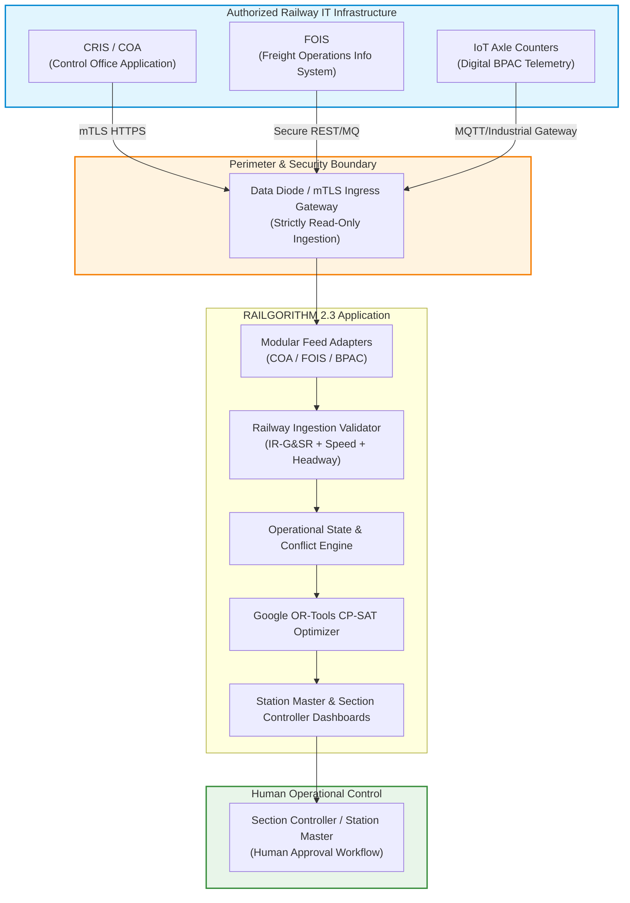

# RAILGORITHM 2.3 — Live Integration Readiness Specification

## 1. Safety Boundary & Non-Negotiable Operating Principles

RAILGORITHM 2.3 is designed to support direct data ingestion from authorized operational railway IT systems. 

To maintain the highest level of railway safety, the system enforces the following non-negotiable principles:

1. **Strictly Read-Only (Unidirectional Telemetry)**:
   - RAILGORITHM connects to operational railway systems in a **strictly read-only** capacity.
   - It possesses **zero writeback capability** to electronic interlocking (EI), signaling relay racks, axle counters, or locomotive traction systems.
2. **Advisory-Only Human Decision Support**:
   - Every schedule adjustment, platform re-assignment, or train precedence recommendation generated by the system is **purely advisory**.
   - No algorithmic recommendation can be applied to field operations automatically.
   - A qualified Station Master or Section Controller must explicitly review, verify, and approve every recommendation before executing manual signal clearance.
3. **Fail-Safe Fallback**:
   - If telemetry becomes unavailable, corrupted, or stale, the application immediately displays visual warning banners, marks metrics as stale, and ceases automated recommendation generation.

---

## 2. Technical Adapter Architecture

RAILGORITHM provides modular data adapters (`backend/app/ingestion/adapters.py`) engineered to interface with standard Indian Railways IT feeds:

### 2.1. CRIS / COA (Control Office Application) Adapter
- **Purpose**: Ingests passenger train movements, station arrival/departure times, train consists, locomotive numbers, and section line clear messages.
- **Protocol**: HTTPS REST API / mTLS with mutual certificate validation.
- **Payload Mapping**:
  - `COA.TrainNo` $\to$ `RawFeedPayload.train_id`
  - `COA.StationCode` $\to$ `RawFeedPayload.location_id`
  - `COA.ActualArrival` / `ActualDeparture` $\to$ `RawFeedPayload.timestamp`
  - `COA.CurrentSpeed` $\to$ `RawFeedPayload.speed_kmph`
- **Validation Rules**: Checked against timetable schedule, train MPS (100–130 km/h), and platform capacity.

### 2.2. FOIS (Freight Operations Information System) Adapter
- **Purpose**: Ingests freight rake movements, wagon type (BOXN, BCN, BTPN), trailing load (tonnes), rake origin/destination, and crew change data.
- **Protocol**: AMQP Message Broker or SFTP XML payload ingestion.
- **Payload Mapping**:
  - Automatically identifies freight rakes and sets `train_type = "FREIGHT"`.
  - Enforces freight speed limit cap: $\text{MPS} \le 75.0\text{ km/h}$ under `IR-G&SR-4.08-FRT`.
  - Flags overloaded rakes or low-speed mineral trains for prioritized loop-line stabling.

### 2.3. IoT Axle Counters & Track Circuit (BPAC) Adapter
- **Purpose**: Sub-second tracking of block section entry, occupancy, clearance, and train direction using digital Block Proving by Axle Counter (BPAC) equipment.
- **Protocol**: MQTT / WebSocket over private APN / industrial railway Ethernet.
- **Payload Mapping**:
  - Ingests discrete `BLOCK_ENTRY` and `BLOCK_EXIT` events.
  - Verifies direction vector ($+x$ for UP line, $-x$ for DOWN line).
  - Matches wheel-in vs wheel-out counts to guarantee absolute block clearance.

---

## 3. Security, Authentication & Isolation Contracts

To safeguard the application from unauthorized access or malicious payload injection:

1. **Authentication & Authorization**:
   - Ingestion endpoints (`/api/v1/ingestion/events` and `/batch`) require cryptographically signed JWT tokens with the `ROLE_INGESTION_GATEWAY` or `ROLE_SECTION_MASTER` role.
   - Unauthorized requests return HTTP 401 Unauthorized or HTTP 403 Forbidden.
2. **Environment Mode Tagging**:
   - All live adapter payloads must carry `environment: "LIVE_OPERATIONAL"`.
   - The ingestion validator verifies that `payload.environment == feed.environment == system.environment`. Any attempt to send synthetic simulation data to live feeds is rejected immediately with `ENVIRONMENT_MISMATCH`.
3. **Rate Limiting & DoS Protection**:
   - Ingestion endpoints enforce rate limits (up to 25,000 events/minute per authorized feed).
   - Payloads exceeding 1 MB are rejected with HTTP 413 Payload Too Large.
4. **Audit Sealing**:
   - Every acknowledged operational event is added to the SQLite WAL append-only SHA-256 hash chain, ensuring an immutable log of field data for post-incident analysis.

---

## 4. Integration Readiness Checklist

Before connecting RAILGORITHM to production railway network feeds, complete the following staging verification protocol:

- [x] **Speed Limit Configuration**: Train-specific MPS rules configured (Freight 75, MEMU 90, Passenger 100, Express 130 km/h).
- [x] **Directional Interlocking**: Block directionality confirmed for all double-line blocks (`B2U`, `B2D`).
- [x] **Headway Parameterization**: Minimum block headway set to 180 seconds.
- [x] **Junction Throat Limiting**: Diamond throat capacity verified ($C=2$ at Malgaon).
- [x] **Environment Separation**: Live and simulation feeds strictly isolated via `EnvironmentMode`.
- [x] **Circuit Breaker Threshold**: Auto-trip set to 5 consecutive validation failures.
- [x] **Recovery Buffer**: Ring buffer configured with 10,000 event capacity for gap recovery.
- [x] **End-to-End Latency**: Sub-millisecond pipeline processing verified ($0.13\text{ ms}$ mean).
- [x] **Audit Chain Verification**: Append-only hash chain integrity passes automated validation.
- [x] **Human Decision-Support Guarantee**: Advisory-only banner displayed on all user interfaces.
