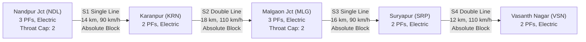

# RAILWAY INFRASTRUCTURE CONFIGURATION SPECIFICATION — RAILGORITHM v2.4

## 1. Overview & Macroscopic Dispatching Architecture

RAILGORITHM v2.4 represents corridor topology as an explicit, strongly-typed domain model. All infrastructure attributes—track lengths, platform electrification, interlocking incompatibilities, signaling block modes, and traction types—are formal configuration inputs. Nothing is inferred from UI state or client payloads.



> [!NOTE]
> **Macroscopic Dispatching Boundary:**
> RAILGORITHM models macroscopic railway corridor movements: station berthing, line clear block occupancy, section headways, and aggregate junction throat bottlenecks. It is an advisory decision-support system and **does not** emulate microscopic vital interlocking relays, point machines, track circuits, or signal aspect cascades. Non-vital schedules must be validated by the Station Master against station working rules and locking tables.

---

## 2. Infrastructure Entity Specification

### 2.1 Station Specification (`Station`)

| Attribute | Type | Default | Description |
| :--- | :--- | :--- | :--- |
| `id` | `str` | *Required* | Unique 3-letter alphabetic station identifier (e.g. `MLG`, `NDL`). |
| `name` | `str` | *Required* | Official geographic station station name (e.g. `Malgaon Junction`). |
| `code` | `str` | `id` | Operating telegraphic station code. |
| `platforms` | `tuple[str, ...]` | *Required* | Tuple of platform berth identifiers (e.g. `("P1", "P2", "P3")`). |
| `x` | `float` | *Required* | Linear corridor coordinate along route axis (0.0 to 4.0). |
| `is_junction` | `bool` | `False` | True if station connects diverging routes with throat convergence. |
| `platform_length_m` | `int` | `600` | Standard platform length in meters (handles standard 24-coach rakes). |
| `junction_throat_capacity` | `int` | `2` | Simultaneous transit capacity through throat before interlocking lock. |
| `platform_electrification` | `bool` | `True` | 25kV AC overhead catenary electrification status of platform tracks. |
| `incompatible_route_pairs` | `tuple[tuple[str, str], ...]` | `()` | Explicit route pairs that cannot be signaled simultaneously (flank protection). |

#### Default Network Station Configuration

```python
Station("NDL", "Nandpur Junction", "NDL", ("P1", "P2", "P3"), 0.0, is_junction=True, platform_length_m=720, junction_throat_capacity=2, platform_electrification=True, incompatible_route_pairs=(("NDL-R1", "NDL-R2"),))
Station("KRN", "Karanpur", "KRN", ("P1", "P2"), 1.0, is_junction=False, platform_length_m=580, platform_electrification=True)
Station("MLG", "Malgaon Junction", "MLG", ("P1", "P2", "P3"), 2.0, is_junction=True, platform_length_m=650, junction_throat_capacity=2, platform_electrification=True, incompatible_route_pairs=(("MLG-R1", "MLG-R3"), ("MLG-R2", "MLG-R3")))
Station("SRP", "Suryapur", "SRP", ("P1", "P2"), 3.0, is_junction=False, platform_length_m=560, platform_electrification=True)
Station("VSN", "Vasanth Nagar", "VSN", ("P1", "P2"), 4.0, is_junction=False, platform_length_m=600, platform_electrification=True)
```

---

### 2.2 Track Block Specification (`Block`)

| Attribute | Type | Default | Description |
| :--- | :--- | :--- | :--- |
| `id` | `str` | *Required* | Unique block section identifier (e.g. `B1`, `B2U`, `B2D`). |
| `direction` | `str` | *Required* | Allowed direction: `UP`, `DOWN`, or `BIDIRECTIONAL`. |
| `run_time_min` | `int` | *Required* | Nominal timetable booked running time in minutes. |
| `gradient_pct` | `float` | `0.0` | Ruling gradient percentage (+ for rising, - for falling). |
| `km_start` | `float` | `0.0` | Kilometric chainage start coordinate along corridor. |
| `km_end` | `float` | `10.0` | Kilometric chainage end coordinate along corridor. |
| `signaling_type` | `str` | `"ABSOLUTE_BLOCK"` | Signaling system: `ABSOLUTE_BLOCK` or `AUTOMATIC_BLOCK`. |

---

### 2.3 Section Specification (`Section`)

| Attribute | Type | Default | Description |
| :--- | :--- | :--- | :--- |
| `id` | `str` | *Required* | Unique section identifier (e.g. `S1`, `S2`, `S3`, `S4`). |
| `from_station` | `str` | *Required* | Origin station ID. |
| `to_station` | `str` | *Required* | Destination station ID. |
| `mode` | `str` | *Required* | Section configuration: `SINGLE` (one bi-directional block) or `DOUBLE` (UP/DOWN pair). |
| `blocks` | `tuple[Block, ...]` | *Required* | Blocks comprising the running section. |
| `headway_min` | `int` | `3` | Minimum operational headway between consecutive trains in same direction. |
| `max_speed_kmph` | `int` | `100` | Sectional Maximum Permissible Speed (WTT Sectional MPS). |
| `distance_km` | `float` | `10.0` | Physical track distance in kilometers. |
| `traction_type` | `str` | `"25kV_AC_ELECTRIC"` | Track electrification standard (`25kV_AC_ELECTRIC` or `DIESEL`). |

#### Default Corridor Section Table

| Section | From | To | Mode | Blocks | Distance (km) | Headway (min) | MPS (km/h) | Traction |
| :--- | :--- | :--- | :--- | :--- | :--- | :--- | :--- | :--- |
| **S1** | NDL | KRN | SINGLE | B1 (Bidirectional, 0–14 km) | 14.0 | 4 | 90 | 25kV AC |
| **S2** | KRN | MLG | DOUBLE | B2U (UP, 14–32 km), B2D (DOWN, 14–32 km) | 18.0 | 3 | 110 | 25kV AC |
| **S3** | MLG | SRP | SINGLE | B3 (Bidirectional, 32–48 km) | 16.0 | 4 | 90 | 25kV AC |
| **S4** | SRP | VSN | DOUBLE | B4U (UP, 48–60 km), B4D (DOWN, 48–60 km) | 12.0 | 3 | 110 | 25kV AC |

---

## 3. Speed Governance Hierarchy Implementation

When telemetry reports speed, `IngestionValidator` resolves permissible ceilings in the following order:

1. **WTT Train Registry (`GR-4.08(1)-TRAIN-MPS`):**
   ```python
   # Verified Working Time Table registrations
   register_train_wtt_mps("12625", 130.0, "WTT-NDLS-TVC-2024-P42")
   register_train_wtt_mps("51831", 100.0, "WTT-PASS-LOCAL-2024-P12")
   register_train_wtt_mps("FRT-701", 75.0, "WTT-FREIGHT-CONTAINER-2024-P08")
   ```
2. **Temporary Speed Restrictions (`GR-4.09-TSR-CAUTION-ORDER`):**
   Registered caution orders dynamic table checked on `location_id`.
3. **Sectional Infrastructure Speed (`WTT-SECTIONAL-MPS`):**
   Resolved from `section.max_speed_kmph` (e.g. S1=90 km/h, S2=110 km/h).
4. **Station Turnout Speed (`IR-SOD-TURNOUT-SPEED`):**
   Capped at 30 km/h for movements inside station interlocking limits.
