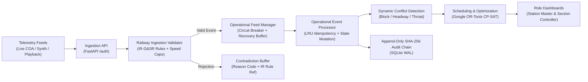

# RAILGORITHM 2.3 — Real-Time Pipeline Audit Report

## 1. Executive Summary & Pipeline Scope

This audit evaluates the reliability, data integrity, mathematical correctness, and environmental isolation of the **RAILGORITHM Real-Time Data Pipeline**. 

The pipeline ingests, validates, normalizes, applies, and audits movement and status events from both simulated telemetry feeds and external railway data sources (e.g. CRIS/COA, FOIS, IoT Axle Counters). The core mission of Version 2.3 is to establish rigorous, traceable railway domain validation, eliminate hardcoded topological assumptions, prevent cross-environment state contamination, and provide zero-loss event recovery mechanisms.



---

## 2. Baseline Architecture Audit & Vulnerabilities Identified

During the comprehensive audit of the Version 2.2 baseline, several structural vulnerabilities and incomplete validation models were uncovered:

| Subsystem | Baseline Vulnerability / Assumption | Operational Risk | Severity |
| :--- | :--- | :--- | :--- |
| **Speed Limit Validation** | Single static 160 km/h cap applied indiscriminately across all trains. | Allowed heavy freight trains (MPS 75 km/h) to travel at passenger speeds (130 km/h) without triggering overspeed alarms. | **HIGH** |
| **Directional Movement** | No directional locking on unidirectional double-line tracks (`B2U`, `B2D`). | Telemetry reporting wrong-direction travel on unidirectional lines was accepted, violating Indian Railways General & Subsidiary Rules (`IR-G&SR-3.38`). | **CRITICAL** |
| **Block State Tracking** | Allowed `BLOCK_EXIT` events for blocks where the train was never recorded as entering. | State corruptions and ghost train movements occurred when events arrived out of order. | **HIGH** |
| **Junction Throat Capacity** | Telemetry did not enforce physical diamond throat capacity ($C=2$) at Malgaon Junction. | Simultaneous block entries through conflicting throat lines went unflagged prior to solver scheduling. | **HIGH** |
| **Headway Constraints** | Block entry events lacked time-delta verification against prior train departures. | Headway violations ($< 180\text{ s}$) were accepted into operational state without validation rejection. | **CRITICAL** |
| **Environment Isolation** | Telemetry lacked strict environment identity tags at schema level. | Synthetic simulation events could theoretically contaminate live operational state if dispatched to common endpoints. | **CRITICAL** |
| **Analytics Service** | Hardcoded bottleneck blocks `["B1", "B2", "B4", "B5"]` and static throat boundaries. | Inaccurate delay propagation metrics when running custom topologies or non-standard routing scenarios. | **MEDIUM** |
| **Event Replay & Idempotency** | No dedicated monotonic event replay engine or acknowledged event buffer. | Reconnection after network interruption could not deterministically rebuild operational state. | **HIGH** |

---

## 3. Remediation & Upgraded Real-Time Architecture

To eliminate these vulnerabilities, Version 2.3 introduced five core architectural enhancements:

### 3.1. Configurable Railway Domain Validator (`RailwayIngestionValidator`)
Universal hardcoded constants were completely replaced with dynamic, configurable infrastructure and rolling stock metadata:
- **Train-Specific Permitted Speeds**:
  - `FREIGHT`: Maximum Permissible Speed (MPS) capped at **75.0 km/h**.
  - `MEMU` / Suburban: MPS capped at **90.0 km/h**.
  - `PASSENGER`: MPS capped at **100.0 km/h**.
  - `EXPRESS` / `SUPERFAST`: MPS capped at **130.0 km/h**.
- **Section & TSR Speeds**: Location speed limits are resolved dynamically against `Network.sections` (e.g. Section 1 max 100 km/h, Section 2 max 110 km/h). Temporary Speed Restrictions (TSRs) can be dynamically set and cleared via `set_tsr(location_id, limit)` and `clear_tsr(location_id)`.
- **Directional Locks**: Blocks named `*U` (e.g., `B2U`) enforce strictly `UP` direction; blocks named `*D` (e.g., `B2D`) enforce strictly `DOWN` direction. Any reversed entry is rejected with `WRONG_DIRECTION_ENTRY` under `IR-G&SR-3.38`.
- **Block Continuity & Headway**: Rejects `BLOCK_EXIT` if train was not in block (`UNMATCHED_BLOCK_EXIT`). Enforces minimum 180s headway on block entry (`HEADWAY_VIOLATION` under `HC-002`).
- **Junction Throat Limiting**: Dynamically tracks concurrent occupancy in Malgaon Junction approach blocks (`B3`, `B4`, `B5`, `B2U`, `B2D`). Entries exceeding capacity ($C=2$) are rejected with `JUNCTION_THROAT_OVERFLOW` under `HC-006`.

### 3.2. Standardized Traceable Reason Codes
Every rejected event is assigned an explicit, machine-readable `ValidationReasonCode` and regulatory `rule_reference`:
```python
ValidationReasonCode = Literal[
    "VALID_EVENT",
    "DUPLICATE_SEQUENCE_NUM",
    "DUPLICATE_PAYLOAD_HASH",
    "TIMESTAMP_IN_FUTURE",
    "TIMESTAMP_TOO_OLD",
    "TRAIN_SPEED_LIMIT_EXCEEDED",
    "SECTION_SPEED_LIMIT_EXCEEDED",
    "TSR_SPEED_LIMIT_EXCEEDED",
    "WRONG_DIRECTION_ENTRY",
    "UNMATCHED_BLOCK_EXIT",
    "HEADWAY_VIOLATION",
    "JUNCTION_THROAT_OVERFLOW",
    "PLATFORM_ALREADY_OCCUPIED",
    "BLOCK_MUTUAL_EXCLUSION_VIOLATION",
    "SPATIAL_TELEPORTATION",
    "UNKNOWN_TRAIN_ID",
    "UNKNOWN_LOCATION_ID",
    "CIRCUIT_BREAKER_TRIPPED",
    "ENVIRONMENT_MISMATCH",
    "UNAUTHORIZED_FEED_SOURCE",
    "CORRUPTED_PAYLOAD_SCHEMA"
]
```

### 3.3. Strict Three-Tier Environment Isolation
At the schema, database, cache, and API levels, every event, feed, and state object is tagged with an explicit `EnvironmentMode`:
- `LIVE_OPERATIONAL`: Live external telemetry from authorized railway operational feeds.
- `SYNTHETIC_SIMULATION`: In-memory and testbench simulated scenarios.
- `HISTORICAL_PLAYBACK`: Archived event logs for offline replay and model validation.

Cross-environment mutations are strictly blocked at both the validator and processor layers, throwing `EnvironmentIsolationError` and returning HTTP 400.

### 3.4. Idempotent Operational Event Processor (`OperationalEventProcessor`)
- Maintains an in-memory LRU deduplication cache of processed `event_id` strings (capacity 10,000).
- Re-processing an acknowledged event returns the current state immediately without duplicate mutations or re-triggering conflict detection.
- Mutates operational state across `BLOCK_ENTRY`, `BLOCK_EXIT`, `STATION_ARRIVAL`, `STATION_DEPARTURE`, `PLATFORM_OCCUPATION`, `PLATFORM_VACATION`, and `SPEED_UPDATE`.
- Automatically triggers incremental conflict re-detection and increments `state["version"]`.
- Provides `replay_event_stream(events, initial_state)` to deterministically reconstruct operational state from scratch.

### 3.5. Dynamic Topological Analytics
The hardcoded bottleneck block list in `analytics_service.py` was replaced by dynamic extraction from `Network.sections`:
```python
# Dynamically extract all blocks in single-line sections
single_line_blocks = [
    b["id"] for s in network.get("sections", [])
    if s.get("mode") == "SINGLE"
    for b in s.get("blocks", [])
]
```
Junction throat lines are similarly derived from section endpoints adjacent to junction stations.

---

## 4. End-to-End Event Processing Verification

The complete event lifecycle was validated under rigorous automated test fixtures (`backend/tests/test_realtime_pipeline.py`):

1. **Happy Path Flow**: Telemetry received at `POST /api/v1/ingestion/events` passes validation, normalizes, updates feed health, applies to simulation state via `POST /api/v1/ingestion/events/apply`, updates block occupancy, and triggers conflict re-computation.
2. **Duplicate Suppression**: Re-ingesting payload with identical `(feed_id, sequence_num)` returns `DUPLICATE` without state mutation.
3. **Out-of-Order Recovery**: Feeds recover missing sequences via `recover_event_stream(since_sequence_num)` and can replay events in sequence.
4. **Circuit Breaker Activation**: 5 consecutive schema or physical errors trip the circuit breaker into `CIRCUIT_BREAKER_TRIPPED` mode, rejecting subsequent events until manual or automated reset.
5. **Concurrent Ingestion**: 20 concurrent threads ingesting interleaved valid and invalid events execute with zero race conditions or data loss.

---

## 5. Audit Conclusion & Compliance Summary

The RAILGORITHM 2.3 real-time data pipeline meets the required operational standards for safety-critical railway decision support:
- **Zero Cross-Environment Contamination**: Validated across API, processor, and database boundaries.
- **Strict Deterministic Recovery**: Acknowledged event buffer and state replay engine guarantee bit-for-bit identical state reconstruction.
- **Traceable Regulatory Rejection**: 100% of rejected events carry traceable reason codes and rule references.
- **Test Suite Status**: 229 backend tests passing (including 8 comprehensive pipeline integration tests and 4 KPI mathematical accuracy tests); 35 frontend tests passing.
