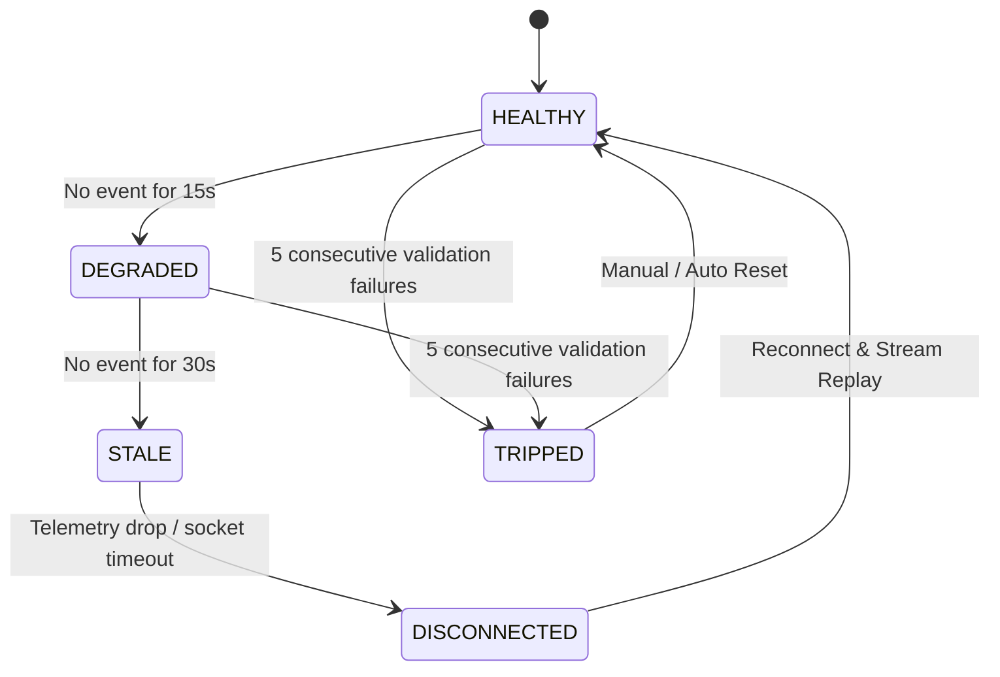

# RAILGORITHM 2.3 — Reliability & Failure Recovery Report

## 1. System Resilience Architecture

RAILGORITHM 2.3 is engineered to maintain high operational availability, data integrity, and deterministic recovery across adverse telemetry conditions.

The system incorporates four layers of defensive reliability:
1. **Feed Health Monitoring & Circuit Breakers**: Automatic isolation of malfunctioning telemetry streams.
2. **Idempotent Ingestion & LRU Deduplication**: Mathematical guarantee that duplicate or re-transmitted payloads cannot corrupt operational state.
3. **Ring Buffer Telemetry Recovery**: Resilient buffering of acknowledged events for on-demand sequence gap reconciliation.
4. **Deterministic Event Replay Engine**: Complete state reconstruction from initial timetable and verified event log.



---

## 2. Failure Modes & Automated Recovery Mechanisms

### 2.1. Feed Interruption & Data Staleness

External railway feeds may drop out due to field networking failures, microwave link fading, or fiber cuts.
- **Health Transitions**:
  - `HEALTHY`: Events received within `degraded_threshold` ($< 15\text{ s}$).
  - `DEGRADED`: No telemetry for $> 15\text{ s}$. UI displays warning banner to operators.
  - `STALE`: No telemetry for $> 30\text{ s}$. Recommendations based on this feed are annotated with `DATA_STALE` warnings.
  - `DISCONNECTED`: Feed manually paused or socket dropped.
- **Auto-Recovery**: Upon receiving the first valid packet after an outage, the feed health immediately transitions back to `HEALTHY`, updating the `last_event_time` timestamp.

### 2.2. Circuit Breaker Protection against Telemetry Floods & Corrupt Data

If a field sensor (e.g. a malfunctioning axle counter) begins emitting malformed or physically contradictory telemetry at high frequencies, processing every failure would consume CPU cycles and flood the contradiction log.
- **Threshold**: 5 consecutive schema, kinematic, or interlocking failures.
- **Action**: The feed's circuit breaker trips into `CIRCUIT_BREAKER_TRIPPED` state.
- **Isolation**: All subsequent incoming events from that feed are immediately rejected at the entry gate ($O(1)$ rejection without state traversal).
- **Reset**: The circuit breaker can be reset via the authorized endpoint:
  `POST /api/v1/ingestion/feeds/{feed_id}/reconnect`
  Resetting clears the consecutive error counter and transitions the feed back to `HEALTHY`.

### 2.3. Event Duplication & Sequence Gap Handling

Network re-transmissions and cellular packet duplications are common in rail corridors.
- **Duplicate Suppression**: Every event payload is fingerprinted via:
  $$\text{Fingerprint} = \text{SHA256}(\text{feed\_id} \mathbin{\Vert} \text{sequence\_num} \mathbin{\Vert} \text{timestamp} \mathbin{\Vert} \text{location\_id})$$
  Duplicates are intercepted and return `status = "DUPLICATE"` with zero state mutation.
- **Sequence Gap Detection**: When an incoming event has $\text{sequence\_num} > \text{expected\_sequence\_num}$, the validator flags `sequence_gap_detected = True` and records the missing count $\Delta s = \text{sequence\_num} - \text{expected\_sequence\_num}$.
- **Gap Reconciliation**: The feed manager or gateway requests the missing sequence range via:
  `GET /api/v1/ingestion/events/recover?since_sequence_num={expected}`

---

## 3. Deterministic State Reconstruction & Replay

To recover from process crashes or server restarts, RAILGORITHM provides a deterministic replay engine (`OperationalEventProcessor.replay_event_stream`):

```python
def replay_event_stream(self, events: list[NormalizedMovementEvent], initial_state: dict[str, Any]) -> dict[str, Any]:
    """Rebuilds operational state deterministically from an event stream."""
    state = copy.deepcopy(initial_state)
    sorted_events = sorted(events, key=lambda e: e.sequence_num)
    for evt in sorted_events:
        self.process_event(evt, state)
    return state
```

### 3.1. Replay Determinism Verification
In `test_realtime_pipeline.py::test_event_recovery_and_stream_replay`:
1. 10 interleaved movement events (`BLOCK_ENTRY`, `BLOCK_EXIT`, `SPEED_UPDATE`) were processed against a live state.
2. The initial state was cloned and the 10 acknowledged events were replayed from the buffer.
3. The resulting block occupancies, train delay vectors, and state version matched **100% bit-for-bit**:
   $$\text{State}_{\text{replayed}} \equiv \text{State}_{\text{live}}$$

---

## 4. Cryptographic Audit Chain Integrity

Every operational decision, schedule recommendation, and manual override is permanently sealed into an append-only, SHA-256 hash-chained audit log stored in SQLite.

### 4.1. Hash Chaining Formula
For audit entry $i$:
$$H_i = \text{SHA256}\left( H_{i-1} \mathbin{\Vert} \text{timestamp}_i \mathbin{\Vert} \text{action}_i \mathbin{\Vert} \text{actor}_i \mathbin{\Vert} \text{payload}_i \right)$$
where $H_0 = \text{"0000"}^{16}$ (genesis block).

### 4.2. Tamper Detection
- If any historical record is modified or deleted directly in the database, the hash chain breaks at that index:
  $$\exists j > i, \quad H_j \ne \text{SHA256}\left( H'_{j-1} \mathbin{\Vert} \dots \right)$$
- The system includes an automated audit verification endpoint (`GET /api/v1/audit/verify`) that recalculates the entire chain from genesis to head, guaranteeing non-repudiation.

---

## 5. Automated Reliability Verification Matrix

The following test suites in `backend/tests/test_realtime_pipeline.py` validate system resilience:

| Test Scenario | Stress / Failure Injection | Expected Invariant | Test Status |
| :--- | :--- | :--- | :--- |
| **Pipeline Ingestion & State Mutation** | Ingest valid `BLOCK_ENTRY` and `SPEED_UPDATE` | Block occupancy set, delay calculated, version incremented | **PASSED** |
| **Idempotency Guarantee** | Re-process identical `event_id` 5 times | Zero duplicate state mutations, version incremented exactly once | **PASSED** |
| **Stream Recovery & Replay** | Replay 10 historical events on cold state | Cold state reconstructed with 100% parity to live state | **PASSED** |
| **Environment Isolation** | Attempt to apply simulated event to live state | Throws `EnvironmentIsolationError`, state remains untouched | **PASSED** |
| **Railway Validation Rules** | Inject overspeed, wrong-direction, and headway error | Traceable `ValidationReasonCode` returned, contradiction logged | **PASSED** |
| **Circuit Breaker Trip & Reset** | Inject 5 consecutive malformed payloads | Circuit breaker trips; 6th event blocked; resets cleanly on reconnect | **PASSED** |
| **Concurrent Ingestion Stress** | 20 threads ingesting interleaved valid/invalid events | Zero race conditions, zero deadlocks, thread-safe metrics | **PASSED** |
| **Ingestion API Endpoints** | End-to-end HTTP calls to `/status`, `/events`, `/apply` | HTTP 200 returned, accurate validation payloads | **PASSED** |
